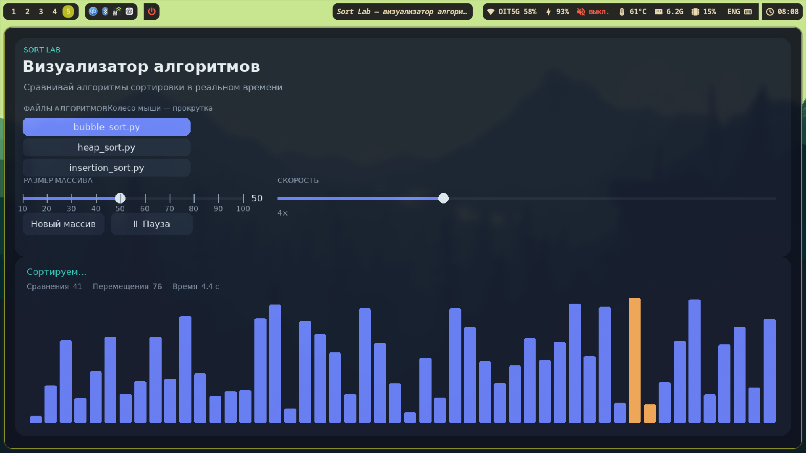

# Sort Lab

Интерактивный визуализатор сортировок на Python и Pygame. Показывает работу алгоритмов на столбцах, позволяет менять размер массива и скорость анимации. Каждый алгоритм хранится в отдельном Python-файле рядом с `main.py`.



## Запуск

```bash
python -m venv .venv
source .venv/bin/activate  # Windows: .venv\Scripts\activate
pip install -r requirements.txt
python main.py
```

Если в окружении уже установлен пакет `pygame`, сначала удалите его (`pip uninstall pygame`), затем установите зависимости из `requirements.txt`. Проект использует Pygame Community Edition (`pygame-ce`), который импортируется в коде как `pygame`.

## Управление

- Выберите файл алгоритма в списке; колесо мыши прокручивает список.
- Меняйте размер массива ползунком от 10 до 100 с шагом 1.
- Перетаскивайте ползунок скорости.
- «Старт» или пробел запускает и приостанавливает сортировку.
- «Новый массив» или R создаёт случайный массив.

## Добавить свой алгоритм

1. Создайте рядом с `main.py` файл с окончанием `_sort.py`, например `insertion_sort.py`.
2. Объявите в нём функцию `sort(values)`. Имя файла показывается в списке выбора.
3. Функция должна быть генератором: на каждом шаге возвращать `Step` из `algorithm_api.py`. Передавайте копию текущих значений и индексы активных элементов. Указывайте `writes` — число ячеек массива, изменённых на этом шаге. Сравнения выдавайте с `writes=0`, а в конце — шаг с `finished=True`.
4. Перезапустите приложение — новый алгоритм появится в списке.

```python
from typing import Iterator

from algorithm_api import Step

def sort(values: list[int]) -> Iterator[Step]:
    data = values.copy()
    for index in range(1, len(data)):
        cursor = index
        while cursor > 0:
            yield Step(data.copy(), (cursor - 1, cursor))
            if data[cursor - 1] <= data[cursor]:
                break
            data[cursor - 1], data[cursor] = data[cursor], data[cursor - 1]
            yield Step(data.copy(), (cursor - 1, cursor), writes=2)
            cursor -= 1
    yield Step(data.copy(), finished=True)
```

## Что показывает MVP

Оранжевым отмечены активные элементы, зелёным — отсортированный массив. На панели отдельно отображаются число сравнений и перемещений, а также время анимации. Перемещения считают записи в ячейки массива: обмен двух элементов — 2, запись при слиянии — 1.

В комплекте есть `bubble_sort.py`, `selection_sort.py`, `insertion_sort.py`, `merge_sort.py`, `quick_sort.py` и `heap_sort.py`. Алгоритмы с разными подходами можно выбрать в списке файлов.
